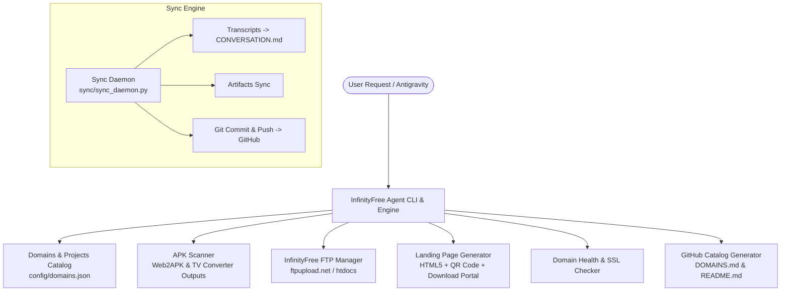

# InfinityFree Account Manager Agent & GitHub Auto-Sync

Build an autonomous agent to manage InfinityFree hosting accounts, domains, and subdomains, deploy and showcase hosted APK projects, and establish continuous two-way synchronization of conversations, artifacts, and codebase changes to GitHub.

## User Review Required

> [!IMPORTANT]
> - **GitHub Repository Name**: We propose creating and linking `thakoralpesh3/infinityfree` (or `thakoralpesh3/infinityfree-manager`). Please let us know if you prefer a different repository name.
> - **InfinityFree Account Credentials**: InfinityFree uses FTP (`ftpupload.net`) and Client Area credentials. We will create a `.env.example` and a secure local `.env` file where you can provide your InfinityFree account details (`IF_FTP_USER`, `IF_FTP_PASS`, `IF_FTP_HOST`).
> - **Local APK Discovery**: The agent will automatically scan your existing APK build outputs (`/home/alpesh/Web2APK_Output` and `/home/alpesh/APK_TV_Converter_Output`) to map your mobile and Android TV APKs to InfinityFree domains.

## Proposed Architecture & Workflow

---

## Proposed Changes

### 1. Repository & GitHub Initialization
#### [NEW] [.gitignore](file:///home/alpesh/infinityfree/.gitignore)
- Ignore sensitive files (`.env`, credentials, local caches, temporary build files).
- Keep config templates and manifests tracked.

#### [NEW] [README.md](file:///home/alpesh/infinityfree/README.md)
- Main project documentation detailing the InfinityFree Manager Agent, CLI commands, domain list showcase, and architecture.

#### [NEW] [DOMAINS.md](file:///home/alpesh/infinityfree/DOMAINS.md)
- Structured live catalog of all InfinityFree domains and subdomains, their current HTTP health status, associated GitHub repositories, and hosted APK assets with direct download links.

---

### 2. Live Conversation & Code Auto-Sync Engine
#### [NEW] [sync/sync_daemon.py](file:///home/alpesh/infinityfree/sync/sync_daemon.py)
- Continuously monitors conversation `ce8d996e-7ead-45d9-aaae-b8c03cf0515a`.
- Converts raw `transcript.jsonl` into a formatted, readable `conversation/CONVERSATION.md` including user inputs, agent replies, thinking blocks, and tool action summaries.
- Copies full transcripts and artifacts (`implementation_plan.md`, `walkthrough.md`) into `artifacts/`.
- Executes automated `git add`, `git commit`, and `git push` to GitHub with customizable interval (`--interval`) or one-shot (`--once`).

#### [NEW] [sync_to_github.sh](file:///home/alpesh/infinityfree/sync_to_github.sh)
- Executable helper script to trigger an immediate sync and push to GitHub.

#### [NEW] [sync/infinityfree-sync.service](file:///home/alpesh/infinityfree/sync/infinityfree-sync.service)
- Systemd user service unit for persistent, background auto-syncing.

---

### 3. InfinityFree Manager Agent Engine
#### [NEW] [agent/config.py](file:///home/alpesh/infinityfree/agent/config.py)
- Loads environment variables, validates FTP and account configurations, and manages multi-account configurations.

#### [NEW] [agent/ftp_client.py](file:///home/alpesh/infinityfree/agent/ftp_client.py)
- High-resilience FTP/FTPS client tailored for InfinityFree (`ftpupload.net:21`).
- Features: connection test, recursive directory creation (`htdocs/apk/...`), file upload with progress, and `.htaccess` MIME-type setup for APK delivery.

#### [NEW] [agent/apk_scanner.py](file:///home/alpesh/infinityfree/agent/apk_scanner.py)
- Discovers APKs from local directories (`/home/alpesh/Web2APK_Output`, `/home/alpesh/APK_TV_Converter_Output`) and GitHub releases.
- Parses app name, version, target architecture (mobile, Android TV, universal), size, and sha256 checksums.

#### [NEW] [agent/portal_builder.py](file:///home/alpesh/infinityfree/agent/portal_builder.py)
- Automatically produces a high-converting, mobile-friendly landing page (`index.html`) for any hosted domain or subdomain.
- Features: responsive dark-mode styling, dynamic QR code for instant phone scanning, app badges, device compatibility chips, and one-click download buttons.

#### [NEW] [agent/catalog.py](file:///home/alpesh/infinityfree/agent/catalog.py)
- Manages `config/domains.json` mapping all InfinityFree domains/subdomains to their active work, projects, and hosted APKs.
- Allows adding, updating, and removing domains.

#### [NEW] [agent/health_checker.py](file:///home/alpesh/infinityfree/agent/health_checker.py)
- Performs HTTP/HTTPS health checks, status code detection, DNS resolution, and verifies APK download URLs.

#### [NEW] [agent/markdown_generator.py](file:///home/alpesh/infinityfree/agent/markdown_generator.py)
- Formats domain and APK data into GitHub markdown (`DOMAINS.md`) with badges and interactive tables.

#### [NEW] [agent/cli.py](file:///home/alpesh/infinityfree/agent/cli.py)
- Command-line interface with subcommands:
  - `list-domains`: Display table of all domains, status, and hosted APKs.
  - `add-domain`: Register a new InfinityFree domain/subdomain and link to project.
  - `deploy`: Package APK + landing portal and upload to InfinityFree domain via FTP.
  - `scan-apks`: Auto-discover local APKs and match them to domains.
  - `health-check`: Test live availability of all domains.
  - `sync-github`: Update `DOMAINS.md` and push to GitHub.

#### [NEW] [infinityfree_agent.sh](file:///home/alpesh/infinityfree/infinityfree_agent.sh)
- Master executable CLI runner.

#### [NEW] [requirements.txt](file:///home/alpesh/infinityfree/requirements.txt)
- Lightweight dependencies (`requests`, `python-dotenv`, `urllib3`, etc.).

---

## Verification Plan

### Automated Tests
1. **GitHub CLI & Remote Verification**:
   - Verify GitHub repo creation and remote branch configuration: `git remote -v` and `gh repo view`.
2. **Conversation & Transcript Sync Test**:
   - Execute `./sync_to_github.sh --once` and confirm that `conversation/CONVERSATION.md` and artifacts are generated, committed, and pushed to GitHub.
3. **Agent CLI Smoke Test**:
   - Run `python3 -m agent.cli --help`
   - Run `python3 -m agent.cli scan-apks` to verify APK discovery from output folders.
   - Run `python3 -m agent.cli list-domains` to verify domain catalog rendering.
   - Run `python3 -m agent.cli sync-github` to verify `DOMAINS.md` generation.
4. **FTP & Deployment Dry-Run**:
   - Test portal builder generation: verify generated HTML has valid QR code and download links.

### Manual Verification
- Review generated `DOMAINS.md` and `README.md` on GitHub at `https://github.com/thakoralpesh3/infinityfree`.
